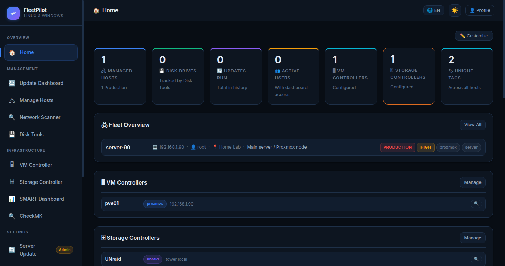
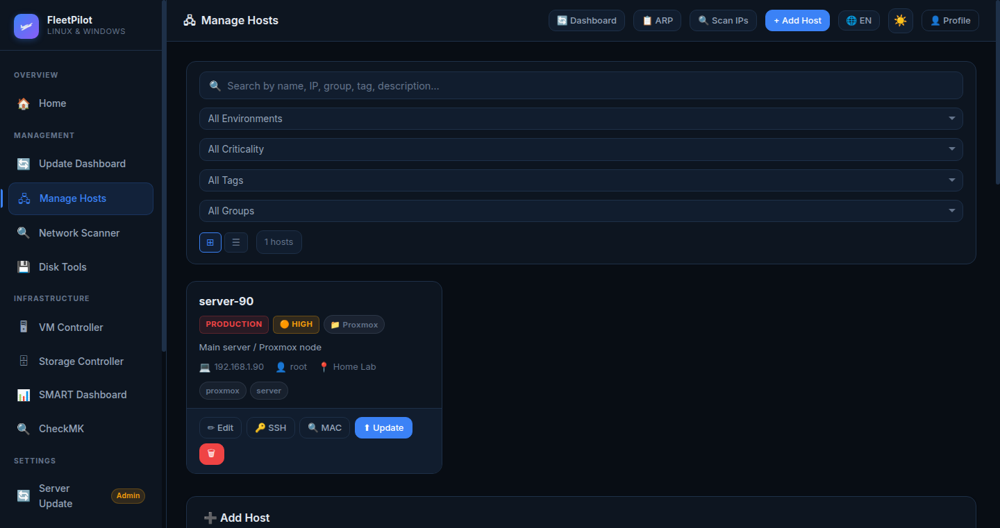
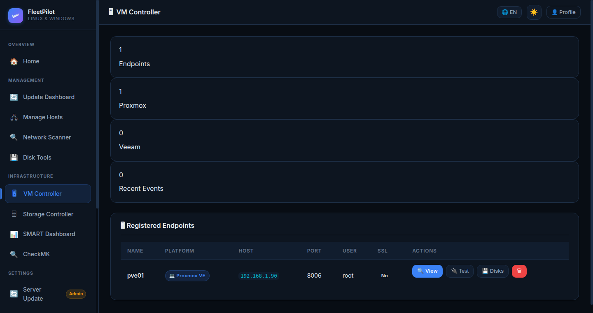

<div align="center">



# FleetPilot

**The self-hosted fleet management dashboard for homelabs and small IT teams.**

Manage Linux & Windows servers, VMs, storage systems, and disks — all from one responsive dark-mode web UI.

[](LICENSE)
[](https://python.org)
[](https://flask.palletsprojects.com)
[](https://github.com/ChristianHandy/FleetPilot)

[Features](#features) · [Screenshots](#screenshots) · [Quick Start](#quick-start) · [User Guides](#user-guides) · [Security](#security)

</div>

---

## What is FleetPilot?

FleetPilot is a modern, self-hosted web dashboard that gives you a single pane of glass over your entire infrastructure. Whether you run a homelab with a few Raspberry Pis or manage dozens of servers, FleetPilot keeps everything under control — without any cloud dependency or subscription fee.

It combines remote update management, disk health monitoring, VM controller integration (Proxmox), storage controller integration (TrueNAS), and CheckMK monitoring into one unified interface with multi-user RBAC and a fully customizable dashboard.

---

## Features

| Category | Capabilities |
|---|---|
| **Dashboard** | Fully customizable widget layout (drag & drop, per-user persistence) |
| **Host Management** | Linux & Windows servers, tags, environments, DHCP/MAC tracking |
| **Remote Updates** | SSH-based updates for Ubuntu, Debian, Fedora, Arch, Windows (winget) |
| **VM Controllers** | Proxmox integration with retry/backoff, VM status overview |
| **Storage Controllers** | TrueNAS and custom storage system management |
| **Routers & repeaters** | AVM FRITZ!Box and FRITZ!Repeater (incl. Mesh), OpenWrt, OPNsense, pfSense, VyOS, DD-WRT/FreshTomato, MikroTik RouterOS, IPFire, plus availability checks for any repeater or access point: status, interfaces, DHCP clients, update checks, encrypted config backups. See [docs/routers.md](docs/routers.md) |
| **Disk & SMART** | Format (ext4/XFS/FAT32), SMART tests, block validation, history |
| **Monitoring** | CheckMK integration and a Prometheus `/metrics` endpoint, both token-authenticated |
| **Alerts** | Email when a disk is newly flagged by SMART, when updates fail, and scheduled reports |
| **Backups** | One-click and daily automatic backups of FleetPilot's own data, with verified restore |
| **User Management** | Multi-user RBAC (Admin / Operator / Viewer), profile management |
| **Security** | Security center, 2FA (TOTP, WebAuthn, YubiKey), session management, API tokens, tamper-evident audit trail, FIPS and offline modes. See [SECURITY.md](SECURITY.md) |
| **Plugins** | Extensible addon system with remote plugin repository |
| **Scheduling** | Automatic updates (daily/weekly/monthly) with email notifications |
| **i18n** | Interface available in EN, DE, FR, ES, NL |
| **Accessibility** | WCAG 2.2 AA checked; text size, high contrast, readable font, spacing, reduced motion, and easy language (EN / German Leichte Sprache). See [docs/accessibility.md](docs/accessibility.md) |

---

## Screenshots

<table>
<tr>
<td width="50%">

**Customizable Dashboard**


</td>
<td width="50%">

**Host Management**


</td>
</tr>
<tr>
<td width="50%">

**VM Controllers (Proxmox)**


</td>
<td width="50%">

**SMART Disk Health**


</td>
</tr>
</table>

---

## Quick Start

### Proxmox VE (one command)

In the **Shell** of your Proxmox node:

```bash
bash -c "$(curl -fsSL https://raw.githubusercontent.com/ChristianHandy/FleetPilot/main/proxmox/fleetpilot-lxc.sh)"
```

This creates an unprivileged Debian container, installs FleetPilot with HTTPS and prints the address and admin password. Update it later with the same command followed by `-- update <container ID>`.

### Debian, Ubuntu or Raspberry Pi OS

As root:

```bash
curl -fsSL https://raw.githubusercontent.com/ChristianHandy/FleetPilot/main/install.sh | bash
```

Then open `https://<server-ip>`, accept the self-signed certificate once and sign in as `admin` with the password the installer shows.

The **[installation guide](docs/installation.md)** ([Deutsch](docs/de/installation.md)) covers all options, unattended installs, your own certificate, updates, backups, high-security settings and troubleshooting.

### Development

```bash
git clone https://github.com/ChristianHandy/FleetPilot.git
```

```bash
cd FleetPilot && python3 -m venv venv && venv/bin/pip install -r requirements.txt
```

```bash
cp .env.example .env && venv/bin/python app.py
```

This serves `http://localhost:5000` for development only; use one of the installers above for real use.

---

## Customizable Dashboard

The dashboard is fully customizable — every user can arrange their own layout:

1. Click **"✏️ Customize"** in the top-right corner
2. **Drag & drop** widgets into any order
3. **Hide** widgets with the red ✕ button; restore them from the "Hidden Widgets" panel
4. Click **"💾 Save Layout"** — persisted per user in the database
5. **"↺ Reset"** restores the default layout

Available widgets: Quick Stats, Fleet Overview, VM Controllers, Storage Controllers, SMART Health, Environment Breakdown, Tag Cloud, Recent Updates, Navigation Cards, Plugin Widgets.

---

## User Guides

| | English | Deutsch |
|---|---|---|
| Installation | [docs/installation.md](docs/installation.md) · [PDF](docs/user-guides/FleetPilot_Installation_EN.pdf) | [docs/de/installation.md](docs/de/installation.md) · [PDF](docs/user-guides/FleetPilot_Installation_DE.pdf) |
| User guide (all features) | [docs/user-guide.md](docs/user-guide.md) · [PDF](docs/user-guides/FleetPilot_User_Guide_EN.pdf) | [docs/de/benutzerhandbuch.md](docs/de/benutzerhandbuch.md) · [PDF](docs/user-guides/FleetPilot_Handbuch_DE.pdf) |

Older guides (version 1.0) in French, Spanish and Italian are in [`docs/user-guides/`](docs/user-guides/).

---

## Plugin System

Extend FleetPilot with custom disk tools and integrations via the addon system. Browse plugins under **System → Plugins** and add one by copying its file into `/opt/fleetpilot/addons`, or create your own — see [PLUGIN_REPOSITORY.md](PLUGIN_REPOSITORY.md).

---

## Home Assistant Integration

`integrations/home-assistant/` contains a Home Assistant custom component that shows SMART health for disks on your servers as sensors, binary sensors and self-test buttons. It runs inside Home Assistant on its own and reads the same `smartctl` data as FleetPilot's SMART pages. See [its README](integrations/home-assistant/README.md) for installation.

This component was previously the separate `HAOS_SMART_Monitor` repository. The older standalone `Disk_Tools` app is fully covered by FleetPilot's Disk Tools pages (`/disks`).

---

## Contributing

Pull requests are welcome. For major changes, please open an issue first to discuss what you would like to change.

---

## License

[MIT](LICENSE) — free to use, modify, and self-host.

---

<div align="center">

Made with care for the homelab community.

⭐ If FleetPilot is useful to you, consider starring the repository — it helps others find it.

</div>
