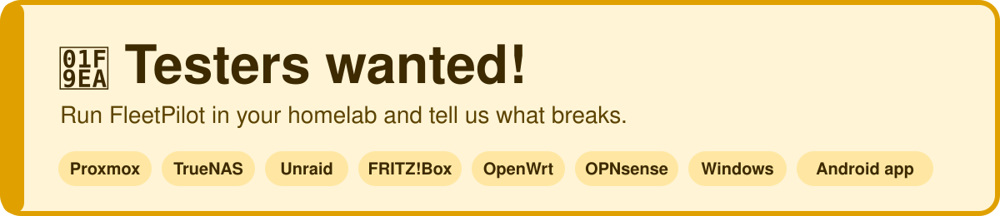

<div align="center">

<a href="https://github.com/ChristianHandy/FleetPilot/issues/new?template=bug_report.yml"></a>

**FleetPilot needs testers.** It's tested against an emulated homelab, but nothing beats real hardware.<br>
Install it, or just [try the live demo](https://christianhandy.github.io/FleetPilot/demo/), and tell us what works and what doesn't:<br>
**[🐞 Report a bug](https://github.com/ChristianHandy/FleetPilot/issues/new?template=bug_report.yml)** · **[💬 Share how it went](https://github.com/ChristianHandy/FleetPilot/discussions)** · [Open issues](https://github.com/ChristianHandy/FleetPilot/issues)

---


# FleetPilot

**One self-hosted dashboard for your homelab: servers, Proxmox, routers, disks and backups.**

Updates for Linux and Windows machines, SMART disk health, FRITZ!Box / OpenWrt / OPNsense routers, Proxmox VMs, TrueNAS and Unraid, backup servers and fans. Agentless over SSH and APIs, with 2FA, audit trail and a one-command Proxmox install.

[](https://github.com/ChristianHandy/FleetPilot/releases/latest)
[](https://github.com/ChristianHandy/FleetPilot/actions/workflows/tests.yml)
[](https://scorecard.dev/viewer/?uri=github.com/ChristianHandy/FleetPilot)
[](https://www.bestpractices.dev/projects/15465)
[](https://www.bestpractices.dev/projects/15465)
[](LICENSE)
[](https://python.org)
[](#how-much-of-fleetpilot-is-written-by-ai)

**⭐ [Star FleetPilot on GitHub](https://github.com/ChristianHandy/FleetPilot)** if it's useful to you: it helps others find it, and [community-scripts.org](https://community-scripts.org) lists apps from 600 stars.


**[▶ Try the live demo](https://christianhandy.github.io/FleetPilot/demo/)** · [Website](https://christianhandy.github.io/FleetPilot/) · [Install](#quick-start) · [Features](#features) · [User guide](docs/user-guide.md) · [Security](SECURITY.md)

The live demo is the real FleetPilot running in your browser against an emulated homelab. Nothing leaves your browser.

</div>

---

## Features

| | |
|---|---|
| **Hosts and updates** | Linux (Debian/Ubuntu and derivatives, Fedora/RHEL family, openSUSE, Arch, Alpine and more) and Windows 10/11 and Server 2016–2025 ([details](WINDOWS_SUPPORT.md)) over SSH: updates with live output, schedules and history |
| **Vulnerability scan** | Known CVEs in server packages ([OSV.dev](https://osv.dev)), Docker images (Trivy) and pfSense/OPNsense, with severity, fixed version and daily alerts |
| **Disks** | SMART health and tests, formatting, block validation, alerts before a disk dies |
| **Proxmox, storage, backups** | Proxmox VMs and containers, TrueNAS and Unraid, Proxmox Backup Server, Duplicati, restic, UrBackup and more |
| **Routers** | FRITZ!Box and Repeater (Mesh), OpenWrt, OPNsense, pfSense, MikroTik, VyOS and more: status, devices, firmware checks, encrypted backups ([details](docs/routers.md)) |
| **Hardware** | Live CPU, memory and temperatures, fan control, Wake-on-LAN, scheduled shutdowns |
| **Security** | 2FA (TOTP, passkeys, YubiKey), roles (Admin / Operator / Viewer), sessions, scoped API tokens, tamper-evident audit trail, security center ([SECURITY.md](SECURITY.md)) |
| **Integrations** | Prometheus `/metrics`, CheckMK, Home Assistant ([component](integrations/home-assistant/README.md)), REST API, [plugins](PLUGIN_REPOSITORY.md), public status page, [Android app (beta)](docs/user-guide.md#android-app-beta) |
| **For everyone** | English, Deutsch, Français, Español, Nederlands, Italiano; WCAG 2.2 AA, high contrast, easy language ([accessibility](docs/accessibility.md)) |

<table>
<tr>
<td width="50%"><b>Home</b><br></td>
<td width="50%"><b>SMART disk health</b><br></td>
</tr>
<tr>
<td width="50%"><b>FRITZ!Box details</b><br></td>
<td width="50%"><b>Security center</b><br></td>
</tr>
</table>

---

## Quick Start

**Proxmox VE**, in the Shell of your node. Creates an unprivileged Debian container with HTTPS and prints the address and admin password:

```bash
bash -c "$(curl -fsSL https://raw.githubusercontent.com/ChristianHandy/FleetPilot/main/proxmox/fleetpilot-lxc.sh)"
```

**Debian, Ubuntu or Raspberry Pi OS**, as root. Then open `https://<server-ip>` and sign in as `admin` with the password the installer shows:

```bash
curl -fsSL https://raw.githubusercontent.com/ChristianHandy/FleetPilot/main/install.sh | bash
```

Guides: **[installation](docs/installation.md)** (options, your own certificate, updates, backups, troubleshooting) and **[user guide](docs/user-guide.md)**, also in [Deutsch](docs/de/benutzerhandbuch.md) and [简体中文](docs/zh-CN/user-guide.md) ([all guides and PDFs](docs/user-guides/)). Development setup: [CONTRIBUTING.md](CONTRIBUTING.md#building-and-running-from-source).

---

## Security and supply chain

FleetPilot holds the keys to your machines, so it's built and released with care: a read-only install with an unprivileged service user; CodeQL, Bandit, zizmor and about 860 tests on every change; fuzzed parsers; every dependency locked by hash and audited; every action pinned to a commit; GPG-signed tags; releases with an SBOM, checksums and Sigstore-signed build provenance (`gh attestation verify fleetpilot-X.Y.Z.tar.gz --repo ChristianHandy/FleetPilot`). Details and how to report a vulnerability: [SECURITY.md](SECURITY.md).

---

## How much of FleetPilot is written by AI?


**Too much, and it needs to go down.** Most of FleetPilot so far was written with AI coding assistants (GitHub Copilot, Manus, Claude). Software that holds the keys to your servers should be written and reviewed by people; that's the goal of the [roadmap](ROADMAP.md#project-more-people-less-ai-written-code).

The bars count the lines each commit changed per month; the line is the share of all code at each month's end (`git blame`), and the note at the top says whether it is going up or down. A commit counts as AI-assisted when its author is a coding agent or its message names an AI co-author, so undeclared AI help is not counted. Rebuilt daily by [`scripts/ai_share.py`](scripts/ai_share.py).

**New code must be AI-free:** the required **AI assistance** check fails pull requests that declare AI help, show strong AI style signals or contain AI leftovers. **Help push it down:** pick a [good first issue](https://github.com/ChristianHandy/FleetPilot/labels/good%20first%20issue), review a pull request, or rewrite AI-written code ([#201](https://github.com/ChristianHandy/FleetPilot/issues/201)).

---

## Contributing

Testers, translators, reviewers and developers are welcome. Start with [CONTRIBUTING.md](CONTRIBUTING.md) and a [good first issue](https://github.com/ChristianHandy/FleetPilot/labels/good%20first%20issue); see also the [code of conduct](CODE_OF_CONDUCT.md), [roadmap](ROADMAP.md) and [governance](GOVERNANCE.md).

## License

[GPL-3.0-or-later](LICENSE): free to use, study, change and share; changed versions you distribute stay under the GPL.
