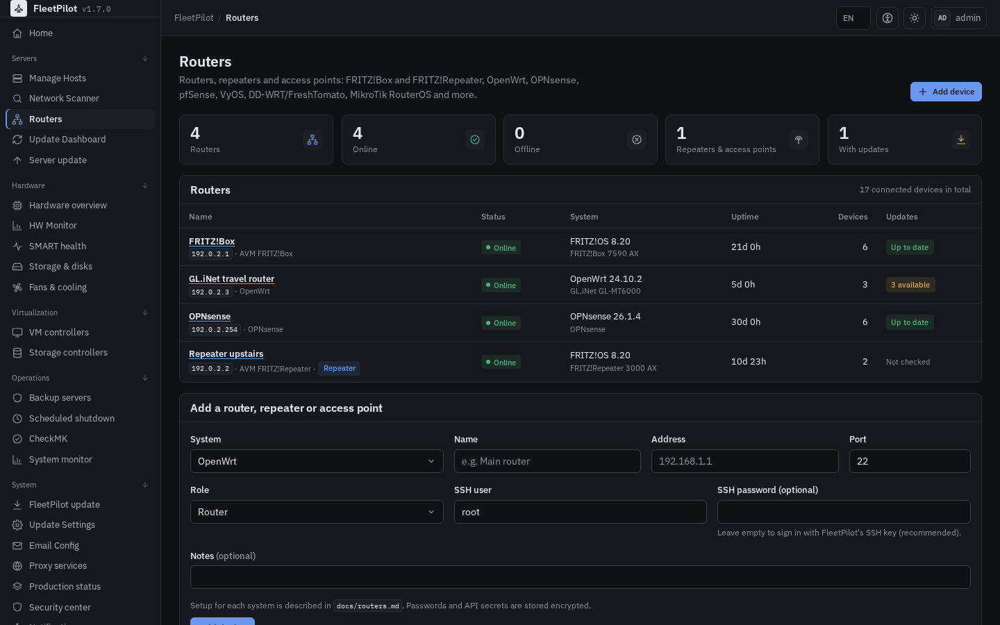
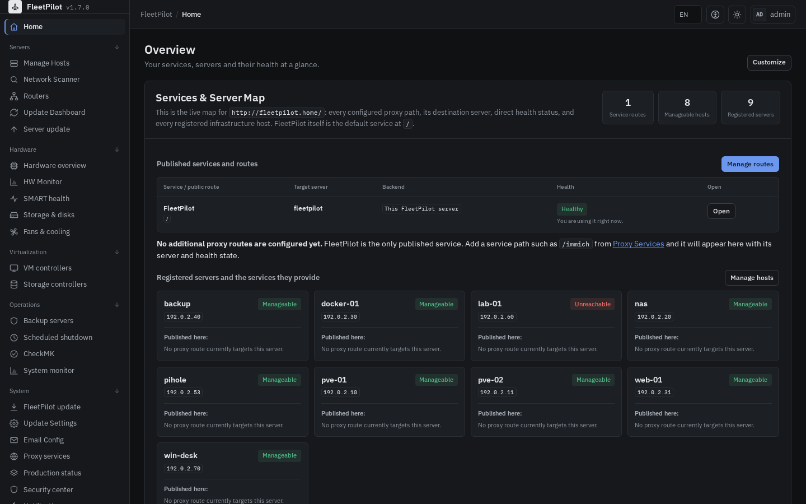
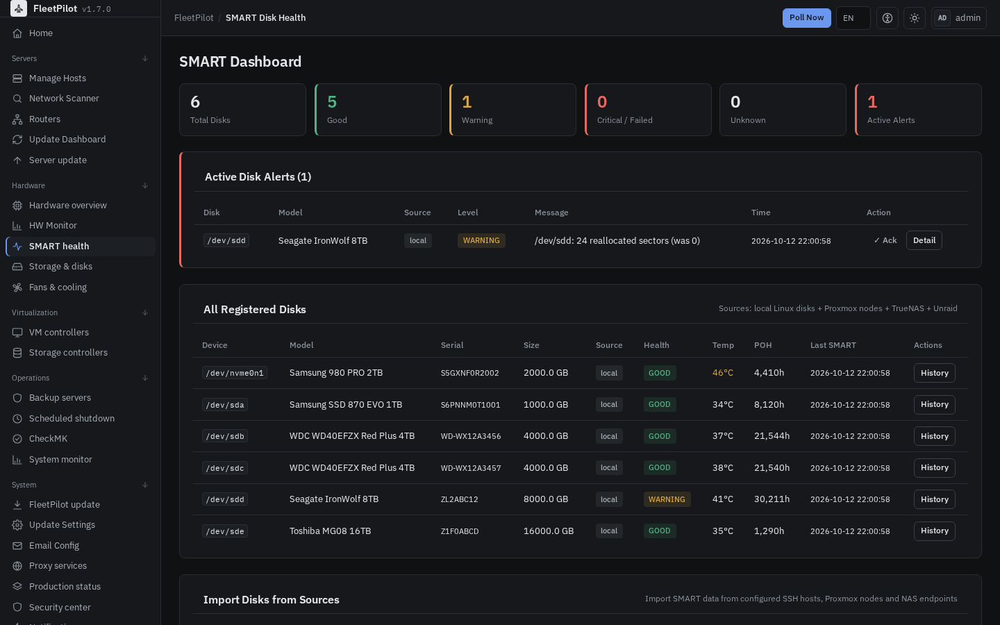
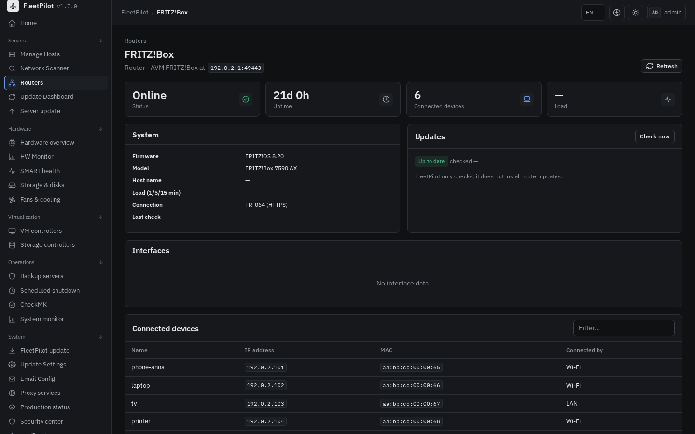
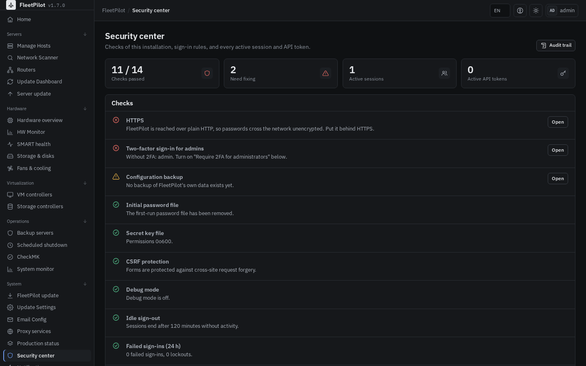
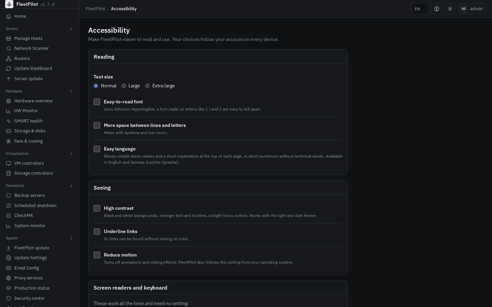
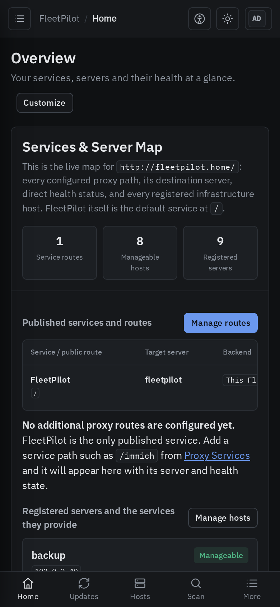

<div align="center">


# FleetPilot

**One self-hosted dashboard for your homelab: servers, Proxmox, routers, disks and backups.**

Updates for Linux and Windows machines, SMART disk health, FRITZ!Box / OpenWrt / OPNsense routers, Proxmox VMs, TrueNAS and Unraid, backup servers and fans. Agentless over SSH and APIs, with 2FA, audit trail and a one-command Proxmox install.

[](https://github.com/ChristianHandy/FleetPilot/releases/latest)
[](https://github.com/ChristianHandy/FleetPilot/actions/workflows/tests.yml)
[](https://scorecard.dev/viewer/?uri=github.com/ChristianHandy/FleetPilot)
[](https://www.bestpractices.dev/projects/15465)
[](https://www.bestpractices.dev/projects/15465)
[](LICENSE)
[](https://python.org)



**[▶ Try the live demo](https://christianhandy.github.io/FleetPilot/demo/)** · [Website](https://christianhandy.github.io/FleetPilot/) · [Install](#quick-start) · [Features](#features) · [Screenshots](#screenshots) · [User guide](docs/user-guide.md) · [Security](SECURITY.md)

> **Test it before you install it.** The live demo is the real FleetPilot, running in your browser (WebAssembly) against an emulated homelab: Proxmox nodes, TrueNAS, a backup server, Linux and Windows machines, a FRITZ!Box, OpenWrt and OPNsense. Updates, Wake-on-LAN, VMs, fans, SMART alerts and router checks all work, and nothing leaves your browser.

**Proxmox VE, in the node's Shell:**

```bash
bash -c "$(curl -fsSL https://raw.githubusercontent.com/ChristianHandy/FleetPilot/main/proxmox/fleetpilot-lxc.sh)"
```

</div>

---

## What is FleetPilot?

FleetPilot is a modern, self-hosted web dashboard that gives you a single pane of glass over your entire infrastructure. Whether you run a homelab with a few Raspberry Pis or manage dozens of servers, FleetPilot keeps everything under control — without any cloud dependency or subscription fee.

It combines remote update management, disk health monitoring, VM controller integration (Proxmox), storage controller integration (TrueNAS), and CheckMK monitoring into one unified interface with multi-user RBAC and a fully customizable dashboard.

---

## Features

| Category | Capabilities |
|---|---|
| **Dashboard** | Fully customizable widget layout (drag & drop, per-user persistence) |
| **Host Management** | Linux servers, and Windows 10/11 (incl. LTSC 2019–2024) and Windows Server 2016–2025 with their support end dates ([details](WINDOWS_SUPPORT.md)); tags, environments, DHCP/MAC tracking |
| **Remote Updates** | SSH-based updates for Ubuntu, Debian, Fedora, Arch and Windows (Windows Update and winget) |
| **Vulnerability scan** | Known CVEs in the packages of every Linux server (Debian, Ubuntu, Proxmox, TrueNAS, Raspberry Pi OS, Alpine, Rocky, Alma) via [OSV.dev](https://osv.dev), Docker images via Trivy, pfSense/OPNsense `pkg audit` and FleetPilot itself; severity, fixed version, daily scan and alerts |
| **VM Controllers** | Proxmox integration with retry/backoff, VM status overview |
| **Storage Controllers** | TrueNAS and custom storage system management |
| **Routers & repeaters** | AVM FRITZ!Box and FRITZ!Repeater (incl. Mesh), OpenWrt, OPNsense, pfSense, VyOS, DD-WRT/FreshTomato, MikroTik RouterOS, IPFire, plus availability checks for any repeater or access point: status, interfaces, DHCP clients, update checks, encrypted config backups. See [docs/routers.md](docs/routers.md) |
| **Disk & SMART** | Format (ext4/XFS/FAT32), SMART tests, block validation, history |
| **Monitoring** | CheckMK integration and a Prometheus `/metrics` endpoint, both token-authenticated |
| **Alerts** | Email when a disk is newly flagged by SMART, when updates fail, and scheduled reports |
| **Backups** | One-click and daily automatic backups of FleetPilot's own data, with verified restore |
| **User Management** | Multi-user RBAC (Admin / Operator / Viewer), profile management |
| **Security** | Security center, 2FA (TOTP, WebAuthn, YubiKey), session management, API tokens, tamper-evident audit trail, FIPS and offline modes. See [SECURITY.md](SECURITY.md) |
| **Plugins** | Extensible addon system with remote plugin repository |
| **Scheduling** | Automatic updates (daily/weekly/monthly) with email notifications |
| **i18n** | Interface available in EN, DE, FR, ES, NL |
| **Accessibility** | WCAG 2.2 AA checked; text size, high contrast, readable font, spacing, reduced motion, and easy language (EN / German Leichte Sprache). See [docs/accessibility.md](docs/accessibility.md) |

---

## Security and supply chain

FleetPilot holds SSH keys and admin access to your machines, so the project is built and released with the same care it asks of you. Checked continuously by [OpenSSF Scorecard](https://scorecard.dev/viewer/?uri=github.com/ChristianHandy/FleetPilot).

| Area | What is in place |
|---|---|
| **Code analysis** | CodeQL (security-extended queries) for the Python code and the GitHub workflows, Bandit, a linter, and ~200 tests on Python 3.11–3.13 for every change |
| **Fuzzing** | The parsers for router, disk and SOAP output are fuzzed with Atheris: ClusterFuzzLite on every pull request, plus a weekly long run |
| **Dependencies** | Every dependency is locked with hashes (`pip install --require-hashes`) and checked with pip-audit; pull requests that add a vulnerable dependency are blocked (dependency review); Dependabot security updates, and version updates only after a 7-day cooldown |
| **CI/CD** | Every action pinned to a full commit SHA and only allowed publishers (GitHub, Google ClusterFuzzLite, OpenSSF Scorecard, zizmor), both enforced by repository settings; least-privilege tokens per job; no stored credentials; workflows audited by [zizmor](https://docs.zizmor.sh); pull requests from outside contributors need approval before CI runs |
| **Branch** | `main` is protected: changes only through pull requests with passing tests and CodeQL, no force-push or deletion, rules apply to admins too |
| **Releases** | GPG-signed tags; each release carries the source archive, a CycloneDX SBOM, `SHA256SUMS` and Sigstore-signed SLSA build provenance: `gh attestation verify fleetpilot-X.Y.Z.tar.gz --repo ChristianHandy/FleetPilot` |
| **Secrets** | Secret scanning with push protection; no credentials in the repository |
| **Reporting** | Private vulnerability reporting, see [SECURITY.md](SECURITY.md) |
| **The app itself** | Read-only install, unprivileged service user, 2FA and passkeys, audit trail, CVE scan of your servers; see [SECURITY.md](SECURITY.md#security-architecture) |

---

## Screenshots

Demo data; every page also has a light theme and works on phones. Try all of it in the **[live demo](https://christianhandy.github.io/FleetPilot/demo/)** (or the lighter [static tour](https://christianhandy.github.io/FleetPilot/tour/)).

<table>
<tr>
<td width="50%"><b>Home</b><br></td>
<td width="50%"><b>SMART disk health</b><br></td>
</tr>
<tr>
<td width="50%"><b>FRITZ!Box details</b><br></td>
<td width="50%"><b>Security center</b><br></td>
</tr>
<tr>
<td width="50%"><b>Accessibility settings</b><br></td>
<td width="50%"><b>On a phone</b><br></td>
</tr>
</table>

---

## Quick Start

### Proxmox VE (one command)

In the **Shell** of your Proxmox node:

```bash
bash -c "$(curl -fsSL https://raw.githubusercontent.com/ChristianHandy/FleetPilot/main/proxmox/fleetpilot-lxc.sh)"
```

This creates an unprivileged Debian container, installs FleetPilot with HTTPS and prints the address and admin password. Update it later with the same command followed by `-- update <container ID>`.

### Debian, Ubuntu or Raspberry Pi OS

As root:

```bash
curl -fsSL https://raw.githubusercontent.com/ChristianHandy/FleetPilot/main/install.sh | bash
```

Then open `https://<server-ip>`, accept the self-signed certificate once and sign in as `admin` with the password the installer shows.

The **[installation guide](docs/installation.md)** ([Deutsch](docs/de/installation.md)) covers all options, unattended installs, your own certificate, updates, backups, high-security settings and troubleshooting.

### Development

```bash
git clone https://github.com/ChristianHandy/FleetPilot.git
```

```bash
cd FleetPilot && python3 -m venv venv && venv/bin/pip install -r requirements.txt
```

```bash
cp .env.example .env && venv/bin/python app.py
```

This serves `http://localhost:5000` for development only; use one of the installers above for real use.

---

## Customizable Dashboard

The dashboard is fully customizable — every user can arrange their own layout:

1. Click **"✏️ Customize"** in the top-right corner
2. **Drag & drop** widgets into any order
3. **Hide** widgets with the red ✕ button; restore them from the "Hidden Widgets" panel
4. Click **"💾 Save Layout"** — persisted per user in the database
5. **"↺ Reset"** restores the default layout

Available widgets: Quick Stats, Fleet Overview, VM Controllers, Storage Controllers, SMART Health, Environment Breakdown, Tag Cloud, Recent Updates, Navigation Cards, Plugin Widgets.

---

## User Guides

| | English | Deutsch |
|---|---|---|
| Installation | [docs/installation.md](docs/installation.md) · [PDF](docs/user-guides/FleetPilot_Installation_EN.pdf) | [docs/de/installation.md](docs/de/installation.md) · [PDF](docs/user-guides/FleetPilot_Installation_DE.pdf) |
| User guide (all features) | [docs/user-guide.md](docs/user-guide.md) · [PDF](docs/user-guides/FleetPilot_User_Guide_EN.pdf) | [docs/de/benutzerhandbuch.md](docs/de/benutzerhandbuch.md) · [PDF](docs/user-guides/FleetPilot_Handbuch_DE.pdf) |

Older guides (version 1.0) in French, Spanish and Italian are in [`docs/user-guides/`](docs/user-guides/).

---

## Plugin System

Extend FleetPilot with custom disk tools and integrations via the addon system. Browse plugins under **System → Plugins** and add one by copying its file into `/opt/fleetpilot/addons`, or create your own — see [PLUGIN_REPOSITORY.md](PLUGIN_REPOSITORY.md).

---

## Android App (beta)

`FleetPilotAndroid/` is a native Android app (Kotlin, Jetpack Compose) for your phone: dashboard, servers, VMs, hardware monitor and fans, with Wake-on-LAN, shutdown, VM power actions and fan control. It signs in with a personal API token and pins FleetPilot's self-signed certificate after you confirm its fingerprint. Get the signed APK from the [releases](https://github.com/ChristianHandy/FleetPilot/releases); setup is in the [user guide](docs/user-guide.md#android-app-beta).

---

## Home Assistant Integration

`integrations/home-assistant/` contains a Home Assistant custom component that shows SMART health for disks on your servers as sensors, binary sensors and self-test buttons. It runs inside Home Assistant on its own and reads the same `smartctl` data as FleetPilot's SMART pages. See [its README](integrations/home-assistant/README.md) for installation.

This component was previously the separate `HAOS_SMART_Monitor` repository. The older standalone `Disk_Tools` app is fully covered by FleetPilot's Disk Tools pages (`/disks`).

---

## Contributing

Pull requests are welcome. For major changes, please open an issue first to discuss what you would like to change.

- [CONTRIBUTING.md](CONTRIBUTING.md): how to contribute, the test policy, code review and coding style
- [Code of conduct](CODE_OF_CONDUCT.md)
- [Roadmap](ROADMAP.md): what is planned for the next year, and what is not
- [Governance](GOVERNANCE.md): roles, decisions and continuity
- [Good first issues](https://github.com/ChristianHandy/FleetPilot/labels/good%20first%20issue): small tasks to start with

---

## Support the project

If FleetPilot is useful to you, a ⭐ on GitHub helps other people find it, and helps it reach the 600 stars that [community-scripts.org](https://community-scripts.org) asks for before listing an app. Bug reports and ideas are welcome in [Issues](https://github.com/ChristianHandy/FleetPilot/issues).

---

## License

[GNU General Public License v3.0 or later](LICENSE) (`SPDX-License-Identifier: GPL-3.0-or-later`, stated in every source file): free to use, study, change and share; changed versions you distribute must stay under the GPL.

---

<div align="center">

Made with care for the homelab community.

⭐ If FleetPilot is useful to you, consider starring the repository — it helps others find it.

</div>
