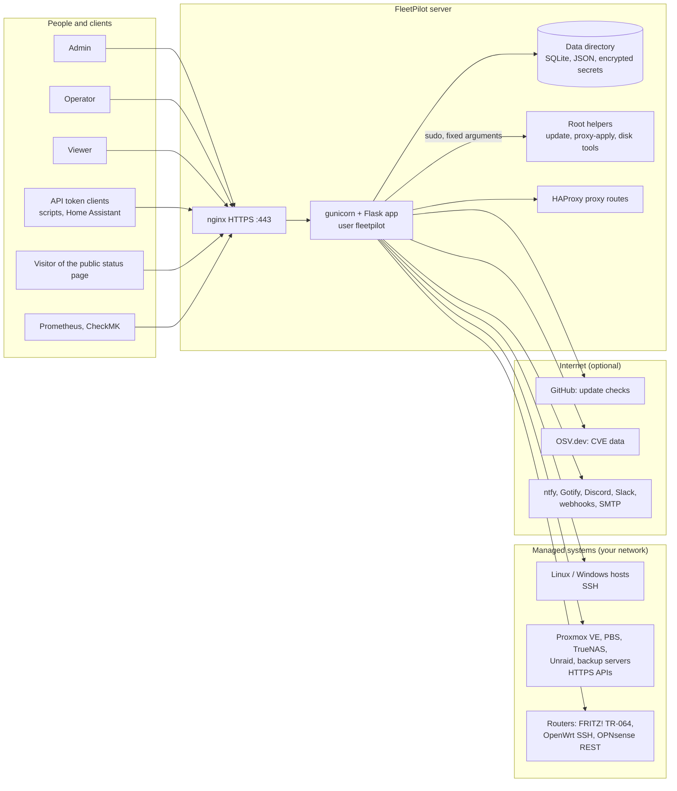

# FleetPilot architecture

How FleetPilot is built: its parts, the actors that use it, every kind of action they take, and where the trust boundaries are. The security assessment and threat model built on this is [security/threat-model.md](security/threat-model.md).

## Overview

## Components

| Component | What it does | Runs as |
|---|---|---|
| **nginx** | Terminates HTTPS (TLS 1.2/1.3), forwards to gunicorn on 127.0.0.1 | root (master), www-data |
| **Flask app** (`app.py` and modules) | Web interface, REST API, all management logic | `fleetpilot`, no login shell, read-only code directory |
| **Background workers** | Polling (host status, SMART, routers, hardware, fans, backups), scheduled updates, daily scans and backups | threads inside the app |
| **Data directory** (`FLEETPILOT_DATA_DIR`) | Users, sessions, audit chain, hosts, device credentials (encrypted with a key derived from `SECRET_KEY`), metrics history | owned by `fleetpilot`, mode 0750 |
| **Root helpers** (`/usr/local/lib/fleetpilot/*`) | The only root actions: apply HAProxy routes, update FleetPilot, disk tools. Fixed arguments, validated input, one narrow sudo rule | root |
| **HAProxy** (optional) | Publishes services behind FleetPilot's proxy routes | haproxy |
| **Installers** (`install.sh`, Proxmox helper) | Create the user, read-only install from hash-locked dependencies, nginx with a certificate, sudo rule | root, once |

## Actors and their actions

| Actor | Authenticates with | Actions |
|---|---|---|
| **Viewer** | Password + optional 2FA (TOTP, passkey, YubiKey) | Read every page: hosts, disks, routers, VMs, vulnerabilities, logs of their own sessions |
| **Operator** | Same | Viewer actions plus: run OS updates, Wake-on-LAN, shutdown/reboot, VM power actions, fan speeds, router refresh/backup/reboot, CVE scans, backups of backup servers |
| **Admin** | Same; sensitive actions ask for the password again | Operator actions plus: add/edit/delete hosts, routers and endpoints (with their credentials), users and roles, security settings, notifications, proxy routes, FleetPilot updates, backups and restores of FleetPilot's data |
| **API token client** | Bearer token (hashed at rest, expiring, read-only or read/write) | The `/api/` endpoints with the rights of the token's owner; never a browser session |
| **Prometheus / CheckMK** | Monitoring token (separate from user accounts) | Read `/metrics` and the CheckMK agent data |
| **Public status page visitor** | None | Read the service status page `/status` (names and states only, no addresses) |
| **Managed host** | FleetPilot authenticates to it with its own SSH key (or a stored password) | Answers commands: OS detection, package lists, updates, SMART, sensors, shutdown. Host keys are trusted on first use, or strictly checked |
| **Appliance / router** | API key, token or user account stored encrypted | Answers status, update, backup and power requests |
| **External services** | Outbound HTTPS only | GitHub (update check), OSV.dev (package names and versions for the CVE scan), notification services and SMTP. All optional; offline mode turns the internet ones off |
| **Maintainer and CI** (supply chain) | GitHub 2FA, signed tags, OIDC for release signing | Publish code and releases; see [GOVERNANCE.md](../GOVERNANCE.md) |

## Trust boundaries

1. **Browser ↔ FleetPilot:** HTTPS, session cookies (Secure, HttpOnly, SameSite), CSRF tokens, CSP, rate-limited sign-in, optional network allowlist.
2. **FleetPilot ↔ managed systems:** SSH and HTTPS initiated by FleetPilot only. Device output is untrusted input: parsers are bounded, XML refuses DTDs, and the parsers are fuzzed.
3. **App ↔ root:** only through the root helpers, with fixed arguments.
4. **FleetPilot ↔ internet:** outbound only, optional, no credentials of managed systems leave the network.
5. **Source ↔ users:** hash-locked dependencies, signed tags, release provenance; see [SECURITY.md](../SECURITY.md#verifying-a-release).

## Data

| Data | Where | Protection |
|---|---|---|
| User passwords | `users.db` | salted scrypt (PBKDF2 in FIPS mode) |
| Sessions, API tokens | data directory | server-side records, tokens hashed |
| Device credentials (SSH passwords, API keys, router passwords) | module databases | Fernet encryption, key derived from `SECRET_KEY` |
| SSH private key | `~fleetpilot/.ssh` | 0600, owned by `fleetpilot` |
| Audit trail | `audit_log.db` | HMAC-chained, tamper-evident, optional SIEM export |
| Backups of FleetPilot data | data directory | checksums, restore verified before it is applied |
